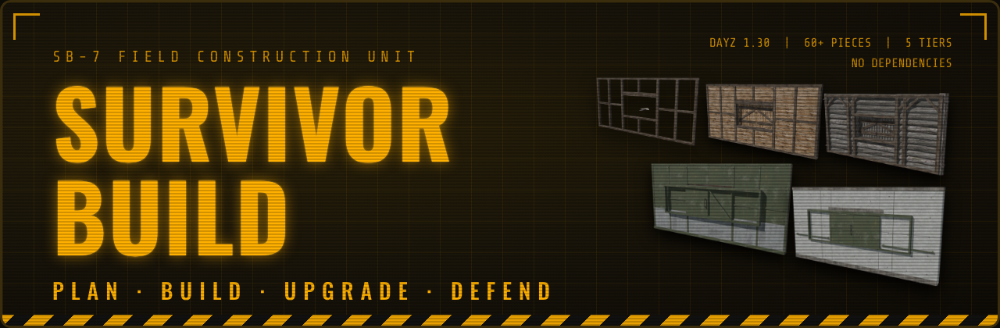

<p align="center">
  
</p>

# SurvivorBuild – Server Owner Guide

SurvivorBuild is a modular base building mod for DayZ 1.30. Players pick a piece on the **Builder's Tablet**, snap it onto a 6 m grid and work it up through five tiers, from a plank frame to concrete. Raiding uses its own C4, optional tool raiding and a raid alarm that can post to Discord. Almost everything is set in one file, `Settings.json`.

This guide is for **server owners and admins**. The short player guide is in [Player basics](#player-basics).

---

## Contents

1. [Install](#install)
2. [Files the mod creates](#files-the-mod-creates)
3. [Getting the items into your world](#getting-the-items-into-your-world)
4. [Player basics](#player-basics)
5. [Tiers and costs](#tiers-and-costs)
6. [Pieces](#pieces)
7. [Raiding](#raiding)
8. [Territory, flags and members](#territory-flags-and-members)
9. [Settings.json, section by section](#settingsjson-section-by-section)
10. [Ready-made setups](#ready-made-setups)
11. [Admin tools](#admin-tools)
12. [Compatibility](#compatibility)
13. [FAQ and troubleshooting](#faq-and-troubleshooting)

---

## Install

1. Subscribe to **SurvivorBuild** on the Steam Workshop (or copy `@SurvivorBuild` to your server).
2. Add it to the server's `-mod=` line. It has no dependencies.
   ```
   -mod=@CF;...;@SurvivorBuild
   ```
3. Copy the key from `@SurvivorBuild/keys` to your server's `keys` folder.
4. Start the server once. The mod writes `profiles/SurvivorBuild/Settings.json` with every option at its default.
5. Put the tablet, cement bags and the mixer kit into your loot economy or trader (see [Getting the items into your world](#getting-the-items-into-your-world)).
6. Edit `Settings.json` and restart.

> **Optional add-on:** `SurvivorBuild_LBCodelock` lets LBmaster's BetterCodelock locks go on SurvivorBuild doors. Load it after both mods. You only need it if you run LBmaster BetterCodelock.

---

## Files the mod creates

All in your server's profile folder (`-profiles=`):

| File | What it is |
|---|---|
| `SurvivorBuild/Settings.json` | Every option. Read at server start. New options are added on their own when the mod updates, and your values are kept. |
| `SurvivorBuild/Territories.json` | Territory flags, their owner, members and each base's own raid-alarm webhook. Only written when territories, shared flags or player raid alarms are in use. |

Lines that start with `SECTION_` in `Settings.json` are just headings. The mod rewrites their text on every start, so editing them does nothing.

---

## Getting the items into your world

SurvivorBuild doesn't put anything in your loot on its own. Add these to `types.xml`, your trader or your spawn loadout:

| Class name | What it is | Notes |
|---|---|---|
| `SB_Blueprint` | **Builder's Tablet**, needed to place pieces | One per player or group. It's not used up. |
| `SB_CementBag` | Cement bag | Goes in the concrete mixer |
| `SB_MixerKit` | Concrete mixer kit | Place it to set up the mixer |
| `SB_ConcreteBrick` | Concrete block | Made by the mixer. You can also sell it or spawn it. |
| `SB_C4Charge_Light` / `SB_C4Charge_Heavy` | C4 | Crafted by players, see [Raiding](#raiding). Add them to a trader if you like. |

Example `types.xml` entries (change the numbers to suit your economy):

```xml
<type name="SB_Blueprint">
    <nominal>8</nominal><lifetime>14400</lifetime><restock>1800</restock><min>4</min>
    <quantmin>-1</quantmin><quantmax>-1</quantmax><cost>100</cost>
    <flags count_in_cargo="0" count_in_hoarder="0" count_in_map="1" count_in_player="0" crafted="0" deloot="0"/>
    <category name="tools"/><usage name="Industrial"/><usage name="Farm"/>
</type>
<type name="SB_CementBag">
    <nominal>15</nominal><lifetime>14400</lifetime><restock>1200</restock><min>8</min>
    <quantmin>-1</quantmin><quantmax>-1</quantmax><cost>100</cost>
    <flags count_in_cargo="0" count_in_hoarder="0" count_in_map="1" count_in_player="0" crafted="0" deloot="0"/>
    <category name="tools"/><usage name="Industrial"/>
</type>
<type name="SB_MixerKit">
    <nominal>3</nominal><lifetime>14400</lifetime><restock>3600</restock><min>1</min>
    <quantmin>-1</quantmin><quantmax>-1</quantmax><cost>100</cost>
    <flags count_in_cargo="0" count_in_hoarder="0" count_in_map="1" count_in_player="0" crafted="0" deloot="0"/>
    <category name="tools"/><usage name="Industrial"/>
</type>
```

---

## Player basics

| Key (default) | What it does |
|---|---|
| **Tablet in hands, B** (or left click) | Open the build menu and pick a piece |
| **Hold left mouse** | Place the piece |
| **Arrow Down** | Snapping on / off |
| **Mouse wheel / Left / Right** | Rotate. While snapped it flips the piece inside / outside |
| **Page Up / Page Down** | Raise / lower the piece |
| **Home / End / Insert / Delete** | Tilt (Alt + Insert/Delete stands a piece up 90°) |
| **Shift / Ctrl** | Fine steps |
| **Arrow Up** | Reset the placement |

All keys can be changed in the game's control settings under **SurvivorBuild**.

**How building goes:**

1. Hold the **Builder's Tablet**, pick a piece and place it. That puts up the **Frame**, paid with planks and nails.
2. Hold a **hammer** (or sledgehammer) and look at the frame. **F** builds it to Wood, then Logs, then Metal.
3. Concrete needs a **shovel** and concrete blocks from the **concrete mixer**.
4. **Repair** damaged pieces with the same tools. **Dismantle** with a crowbar, hatchet, axe or sledgehammer.

Materials can come from your inventory, from the ground right next to you, and from your own **Material Bench** within 30 m. Server owners can also allow storage near the tablet.

**Finishes:** hold the tablet, look at a wall or floor and press **F** → *Choose finish…* to open the finish picker. The tablet remembers your pick, so **F** paints the next wall or floor with it.

---

## Tiers and costs

| Tier | How | Default cost (per 6 × 6 piece) |
|---|---|---|
| **Frame** | Place with the tablet | A share of the piece's planks and nails |
| **Wood** | Hammer | The rest of the planks and nails |
| **Logs** | Hammer | 2 wooden logs + 20 nails |
| **Metal** | Hammer | 3 metal sheets + 30 nails |
| **Concrete** | Shovel | 12 concrete blocks + 20 nails + 1 metal sheet |

Bigger pieces cost more on their own. A hangar door costs about 2.5×, a heli hatch 3.5× and the big heli hatch 7×. Decorations (lamps, rug, ladders, bench) are flat-priced.

Change any of this in `UpgradeCosts`. Add a `Frame` or `Wood` entry there to replace the built-in plank / nail costs.

**Concrete mixer:** put in cement bags and stones, pour in water and gasoline, then start it. Default: 1 bag + 6 stones + 2 L water + 0.3 L fuel → 10 blocks in 120 s. All of these are in section 13.

---

## Pieces

About 60 pieces in six groups. Every one can be switched off with `DisabledPieces`.

| Group | Pieces |
|---|---|
| **Foundations** | Foundation, Triangle Foundation, Pillar |
| **Floors & Roofs** | Floor, Mesh Floor, Peek Floor, Stair Floor, Triangle / Mesh Triangle Floor, Half / Half Mesh Floor, Small / Small Mesh Floor, Flat Roof, Sloped Roof, Hip Roof, Hatch Floor, Heli Hatch (12 × 6), Big Heli Hatch (12 × 12) |
| **Walls** | Wall, Half Wall, Firing Slit Wall, Battlements, Small Wall, Small Half Wall, Sloped Wall L/R, Railing |
| **Doors & Windows** | Door Wall, Double Door, Window Wall, Narrow Door, Half Door, Doorway, Barred Window, Small Window, Garage Door, Vault Door, Secret Bookcase, Hangar Door |
| **Gates & Defense** | Double Gate, Single Gate, Defense Wall, Defense Gate, Double-wide Gate, Drawbridge, Chain-link Fence, Fence Gate, Barbed Wire Fence, Watchtower |
| **Stairs & Decor** | Stairs, Wall Stairs, Ramp, Standing Lamp, Ceiling Lamp, Light Switch, Rug, Step Ladders, Material Bench |

**Extras on pieces:**
- **Doors:** an owner lock (F, no code lock needed) or a vanilla digital code lock (needs a charged 9V battery).
- **Windows:** glass and camo nets.
- **Walls and floors:** finishes.
- **Hatch Floor:** hammer-built stairs.

---

## Raiding

Everything is off or on per server.

| Way in | Default | Settings |
|---|---|---|
| **SurvivorBuild C4** | On | Section 08. Light C4 = Plastic Explosive + 9V battery. Heavy C4 adds another Plastic Explosive. Charges needed: Frame 1 · Wood 1 · Logs 2 · Metal 3 · Concrete 4 (heavy counts as 2). 20 s fuse, can be defused. |
| **Other explosives** (grenades, vanilla charges…) | Off | `AllowOtherExplosives` |
| **Gunfire** | Off | `AllowFirearmDamage` |
| **Melee** | Off | `AllowMeleeDamage` |
| **Tool raiding** (doors only) | Off | Section 09. Time and tool damage per tier, e.g. Metal = sledgehammer, 600 s. |

**Extra raid rules:**
- **Raid windows:** only allow raiding on certain days and hours (`RaidTimeEnabled`, `RaidWindows`).
- **Raid lock:** no building, repairing or dismantling near a base that was just hit (`RaidLockSeconds`).
- **C4 jams doors:** a door with armed C4 on it can't be opened. What a door turns into when C4 kills it is set by `C4DoorResult`.
- **Raid alarm:** the owner and flag members get an in-game warning, and an admin Discord channel can get a message with the attacker's name. Flag owners can set **their own** Discord webhook at the flag; those messages never name the attacker.

---

## Territory, flags and members

SurvivorBuild uses the vanilla **Territory Flag**.

- **`FlagMembersShareBase`** (on): players added at a flag count as owners of every piece around it. They can open its doors and build, upgrade and repair it.
- **To add teammates:** stand at the flag with them next to you, hands empty, and use **Add nearby players to territory**. The owner can remove members, and members can leave.
- **`TerritoryEnabled`** (off): turns on full territories. Nobody else can build within `TerritoryRadius` (60 m) of someone's flag. With `TerritoryRequired` a flag is needed before anyone can build.
- **Raid alarm webhook:** the flag owner sets it with **F** on the flag → *Raid alarm Discord…*. Paste a Discord webhook link and a message, then press **Test**.

---

## Settings.json, section by section

### 01 – General

| Option | Default | What it does |
|---|---|---|
| `SnapDistance` | 3.5 | How far (m) a snap point catches your aim. The nearest free spot within 6 m is still used. |
| `AutoFaceInside` | true | Snapped walls and doors turn their inside toward the base. The arrows still flip them. |
| `AllowTierSkip` | false | true: the hammer can pick a target tier (Wood → Concrete in one go, paying only the target tier) |
| `AllowDismantle` | true | Players can dismantle pieces |
| `OnlyOwnerCanDismantle` | true | Only the owner and flag members can dismantle |
| `OnlyOwnerCanUpgrade` | false | Only the owner and flag members can upgrade |
| `OwnerLockEnabled` | true | Owners and flag members can **Lock / Unlock** a door with F, no code lock needed. A locked door only opens for them. |
| `PieceLifetimeDays` | 0 | 0 = pieces never decay. Otherwise the days a piece lasts. |
| `DisabledPieces` | [] | Pieces that can't be built. Use the piece name (`"Heli_Hatch"`) or a class name (`"SB_Metal_Wall"`). |
| `CodeLockRememberPlayers` | true | Anyone who opened a code lock with the right code gets one-press entry afterwards. Changing the code forgets them. |

### 02 – Admins

| Option | Default | What it does |
|---|---|---|
| `AdminFreeBuild` | true | Admins build without materials or tools, instantly |
| `AdminIDs` | [] | Steam64 IDs of your admins |

### 03 – Costs and tools

| Option | What it does |
|---|---|
| `UpgradeTools` | Tools that build and upgrade (default Hammer, SledgeHammer) |
| `DismantleTools` | Tools that dismantle (Crowbar, Hatchet, WoodAxe, FirefighterAxe, SledgeHammer) |
| `TierTools` | Extra tool needed for a tier (Concrete: Shovel / FieldShovel) |
| `UpgradeCosts` | Materials per tier. `{"Item": "MetalPlate", "Count": 3}` |
| `HatchStairsCost` | Stairs under a Hatch Floor (6 planks + 15 nails) |
| `GlassCost` | Glass for windows |

### 03B – Build times (seconds)

| Option | Default |
|---|---|
| `PlaceSeconds` | 0.3 (placing with the tablet) |
| `UpgradeSeconds` | 7.5 |
| `RepairSeconds` | 5 |
| `DismantleSeconds` | 10 |

### 04 – Materials at the base

| Option | Default | What it does |
|---|---|---|
| `GroundMaterialsRadius` | 3 | Materials on the ground this close always count (logs that don't fit a backpack). 0 = off. |
| `NearbyMaterialsEnabled` | false | Storage near a Builder's Tablet that's been put down also counts |
| `NearbyMaterialsRadius` | 15 | Range for that storage |
| `NearbyMaterialsFromStorage` | true | Look inside containers too |

### 05 – Vanilla building

| Option | Default | What it does |
|---|---|---|
| `VanillaBuildingEnabled` | true | false blocks vanilla fence and watchtower building |
| `VanillaBuildingBlocked` | list | The vanilla kits that get blocked |

### 06 – Raid damage

`RaidEnabled`, `AllowExplosiveDamage` (true), `AllowOtherExplosives` (false), `AllowFirearmDamage` (false), `AllowMeleeDamage` (false), and a multiplier for each (`FirearmDamageMultiplier`, `ExplosiveDamageMultiplier`, `MeleeDamageMultiplier`, 1.0 = normal).

### 06B – Raid lock

| Option | Default | What it does |
|---|---|---|
| `RaidLockSeconds` | 0 | 0 = off. e.g. 600 = no building near a base for 10 min after the last raid hit. |
| `RaidLockRadius` | 40 | Metres around the hit piece |
| `RaidLockBlocksPlacing` | true | Also blocks placing new pieces there |

### 06C – Raid alarm

| Option | Default | What it does |
|---|---|---|
| `RaidAlarmEnabled` | true | In-game warning to the owner and flag members |
| `RaidAlarmCooldownSeconds` | 300 | One warning per base this often |
| `RaidAlarmDiscordWebhook` | "" | Admin channel webhook. Shows the attacker's name and ID. |
| `RaidAlarmPlayerWebhooks` | true | Flag owners can set their own webhook and message at the flag (no attacker name) |

### 06D – Car horn opens gates

| Option | Default | What it does |
|---|---|---|
| `HornOpensDoors` | true | A short honk opens or closes the nearest gate, garage door, hangar or drawbridge. Owner and flag members only; code locks still apply, and it locks again behind you. |
| `HornDoorRadius` | 25 | Metres from the car |

### 06E – Vehicles and walls

| Option | Default | What it does |
|---|---|---|
| `BlockVehicleDoorsThroughWalls` | true | Stops players getting in or out of a car through a base wall. If a player still lands on the wrong side, they're put back and the server log records it. |

### 07 – Raid times

`RaidTimeEnabled` (false) and `RaidWindows`. Each window has `Days` (`"All"`, `"Mon"`, `"Sat"`…), `Start` and `End` (`"18:00"`, `"23:00"`, server time).

### 08 – C4

| Option | Default | What it does |
|---|---|---|
| `C4Enabled` | true | |
| `C4Pieces` | doors, gates, hatches | What C4 can be put on |
| `C4Frame` … `C4Concrete` | 1 / 1 / 2 / 3 / 4 | Charges needed per tier |
| `C4LightPower` / `C4HeavyPower` | 1 / 2 | How many charges one C4 counts as |
| `C4FuseSeconds` | 20 | |
| `C4AllowDefuse` / `C4DefuseSeconds` | true / 6 | |
| `C4JamsDoors` | true | A door with armed C4 on it can't be opened |
| `C4DoorResult` | 0 | 0 = breached (stands open, repairable), 1 = drops back to Frame, 2 = destroyed |
| `C4RecipeExplosive` / `C4RecipeTrigger` / `C4HeavyRecipeExtra` | Plastic_Explosive / Battery9V / Plastic_Explosive | Crafting ingredients |

### 09 – Tool raiding

`ToolRaidEnabled` (false), `ToolRaidDoorsOnly` (true), `ToolRaidPieces`, `ToolRaidTiers`. Defaults per tier:

| Tier | Time | Tool damage | Tools |
|---|---|---|---|
| Frame | 30 s | 5 | hatchet, axes, sledgehammer, crowbar |
| Wood | 300 s | 40 | wood axe, firefighter axe, sledgehammer |
| Logs | 450 s | 60 | firefighter axe, sledgehammer |
| Metal | 600 s | 100 | sledgehammer |
| Concrete | 1200 s | 200 | sledgehammer |

### 10 – Durability

Turn on with `HealthScaleEnabled`. Then use `HealthMultiplier` (everything), `DoorHealthMultiplier` and `WallHealthMultiplier`, `TierHealthMultipliers` and `PieceHealthMultipliers`. `HealthScaleAffectsC4AndToolRaid` (true) means 2× health also needs 2× C4 and 2× raid time.

### 11 – Territory

`TerritoryEnabled` (false), `TerritoryRadius` (60), `TerritoryBlockOthers` (true), `TerritoryRequired` (false), `TerritoryProtectFromDismantle` (true), `FlagMembersShareBase` (true).

### 12 – Base limits (0 = no limit)

`BaseLimitsEnabled` (false), `MaxDoors` (15), `MaxWindows` (2), `MaxCodeLocks`, `MaxBaseWidth` (in 6 m cells), `MaxBaseFloors`, `MaxPiecesPerBase`, plus the `DoorPieces` and `WindowPieces` lists that decide what counts as a door or a window.

### 13 – Concrete mixer

`MixerBagsPerBatch` 1, `MixerStonesPerBatch` 6, `MixerWaterPerBatch` 2, `MixerFuelPerBatch` 0.3, `MixerSeconds` 120, `MixerBlocksPerBatch` 10, `MixerWaterMax` 10, `MixerFuelMax` 5.

### 14 – Barbed wire

| Option | What it does |
|---|---|
| `FenceCutEnabled` | Climbing a barbed fence hurts |
| `FenceCutHealth`, `FenceCutBlood`, `FenceCutBleedChance`, `FenceCutGloveFactor`, `FenceCutClothesDamage` | How much it hurts, and how much gloves help |
| `FenceCutPieces` | Pieces that cut when climbed. Format `"Piece:Tier"`, `*` = every tier. |
| `NoClimbPieces` | Pieces nobody can climb at all (e.g. `"Def_Wall:Logs"`, `"Fence:*"`) |

### 15 – Floor placement

| Option | Default | What it does |
|---|---|---|
| `FloorPlaceEnabled` | true | Other mods' deployables (storage, machines…) can be put down on SB foundations and floors |
| `FloorPlaceDeny` | [] | Class names that may not (inherited classes count) |
| `FloorPlaceAlways` | [] | Class names that always use floor placement |

### 16 – Material Bench

| Option | Default | What it does |
|---|---|---|
| `MaterialBenchForBuilding` | true | What's in your own benches counts when you build, upgrade or repair nearby |
| `MaterialBenchRadius` | 30 | Metres from the player |
| `MaterialBenchItems` | logs, planks, sheets, nails, wire, blocks, cement, stones | What the bench takes, its section, and how many fill its spot on the rack |

---

## Ready-made setups

**PvE: no raiding at all**
```json
"RaidEnabled": false,
"C4Enabled": false,
"ToolRaidEnabled": false,
"RaidAlarmEnabled": false
```

**PvP: C4 only, weekend evenings**
```json
"RaidEnabled": true,
"AllowExplosiveDamage": true,
"AllowFirearmDamage": false,
"AllowMeleeDamage": false,
"C4Enabled": true,
"RaidTimeEnabled": true,
"RaidWindows": [ { "Days": ["Fri", "Sat", "Sun"], "Start": "18:00", "End": "23:00" } ],
"RaidLockSeconds": 600
```

**Hardcore: tool raiding and tougher concrete**
```json
"ToolRaidEnabled": true,
"HealthScaleEnabled": true,
"TierHealthMultipliers": [ { "Name": "Concrete", "Multiplier": 1.5 } ]
```

**Keep bases small**
```json
"BaseLimitsEnabled": true,
"MaxBaseWidth": 6,
"MaxBaseFloors": 3,
"MaxDoors": 10,
"MaxCodeLocks": 5
```

**Switch pieces off**
```json
"DisabledPieces": ["Heli_Hatch_Large", "Vault_Door", "Secret_Door"]
```

---

## Admin tools

Admins listed in `AdminIDs` get extra options on any piece:
- **[ADMIN] Upgrade / Upgrade to …:** instant upgrade, no materials.
- **[ADMIN] Base tools (hold F):** the base admin panel. It shows the owner, piece count, tiers, damaged pieces and blown doors, and acts on every piece connected to the one you looked at:
  - repair all
  - take ownership
  - open all doors
  - delete a piece or the whole base

With `AdminFreeBuild` on, admins build instantly with no materials or tools.

---

## Compatibility

- **DayZ 1.30**, no other mods required.
- **Expansion** (Core / BaseBuilding): runs alongside it. The get-out-of-car-through-a-wall check also covers vanilla fences and other base-building walls.
- **LBmaster BetterCodelock:** load the optional `SurvivorBuild_LBCodelock` PBO.
- **Other mods' storage:** can be placed on SB floors (section 15).

---

## FAQ and troubleshooting

**A piece won't snap.** Aim at the edge where it should go, or at the top of the wall it sits on. **Arrow Down** turns snapping off and on. A floor only snaps straight up a storey when a wall or pillar stands on that cell to hold it.

**Players say "Not enough materials".** Look at the piece with the tablet: the info panel lists what's missing. Materials on the ground within 3 m and in your Material Bench within 30 m count too.

**My new settings didn't do anything.** The server reads `Settings.json` at start, so restart after editing. Check it's valid JSON. If the file can't be read (a missing comma, a stray quote), the mod runs on its defaults instead.

**The raid alarm "Test" posts nothing to Discord.** The link must be a full Discord webhook (`https://discord.com/api/webhooks/<id>/<token>`). Check the server's script log for `raid alarm: Discord webhook error`.

**Can I reset one player's base?** Use **[ADMIN] Base tools → delete base** while looking at any piece of it.

---

Made by **King** · Solitude DayZ
